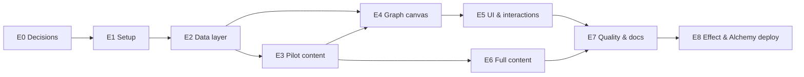

# Tasks

Разбивка проекта на этапы и задачи. Формат: `ID` · задача · зависимости · критерий готовности (DoD).
🎓 отмечает React-концепции, которые практикуются в задаче: в них удобно писать код самому или разбирать его вместе.

---

## E0 · Решения ✅
- [x] **T0.1** Формат: своё веб-приложение
- [x] **T0.2** Стек: React + TS + Vite + React Flow + ELK
- [x] **T0.3** Язык контента: English
- [x] **T0.4** Карты: Frontend, Backend, Web Fundamentals, DevOps, All
- [x] **T0.5** Реестр узлов → [NODES.md](./NODES.md)
- [x] **T0.6** Ответить на открытые вопросы (см. «Решения» внизу)
- [x] **T0.7** Утвердить план (PLAN + NODES + TASKS) → старт E1

---

## E1 · Инициализация проекта ✅
| ID | Задача | Зависит от | DoD |
|---|---|---|---|
| T1.1 ✅ | Vite + React + TypeScript (strict), `npm run dev` | T0.6 | Пустая страница открывается |
| T1.2 ✅ | Зависимости: `@xyflow/react`, `elkjs`, `yaml`, `effect`, `react-markdown`, `remark-gfm`, `rehype-highlight`; dev: `vitest`, `tsx`, `oxlint`, `oxfmt` | T1.1 | `npm install` без ошибок |
| T1.3 ✅ | Структура папок `content/`, `src/content`, `src/layout`, `src/components`, `src/state`, `scripts/` | T1.1 | Структура соответствует PLAN §3 |
| T1.4 ✅ | Скрипты: `dev`, `build`, `test`, `lint`, `format`, `validate`, `typecheck` | T1.2 | Все скрипты запускаются |
| T1.5 ✅ | Локальный `git init`, `.gitignore`, первый коммит. GitHub-репозиторий создаём после утверждения плана | T1.1 | Репозиторий создан |

---

## E2 · Слой данных (чистая логика, без UI) ✅
| ID | Задача | Зависит от | DoD |
|---|---|---|---|
| T2.1 ✅ | `content/maps.yaml`: карты и категории (id, name, description, color, order) | T1.3 | Все категории из NODES.md описаны |
| T2.2 ✅ | `schema.ts`: Effect Schema для frontmatter узла и `maps.yaml` (enum'ы status/kind, kebab-case id, url) | T1.2 | Невалидный объект даёт читаемую ошибку |
| T2.3 ✅ | `parse.ts`: разделение `---frontmatter---` и тела, map/category из пути, проверка `id === filename` | T2.2 | Unit-тесты проходят |
| T2.4 ✅ | `load.ts`: `import.meta.glob` (браузер) и `fs` (CLI) поверх общего `parse` | T2.3 | Один и тот же результат в обоих окружениях |
| T2.5 ✅ | `graph.ts`: индекс узлов, рёбра, обратные связи (backlinks), ghost-узлы для карты, проверки: дубли id, битые `to`, неизвестная категория, связь сама на себя | T2.4 | Unit-тесты на все проверки |
| T2.6 ✅ | `scripts/validate.ts`: CLI, печатает ошибки и предупреждения, exit code 1 при ошибках | T2.5 | `npm run validate` работает |

---

## E3 · Пилотный контент ✅
| ID | Задача | Зависит от | DoD |
|---|---|---|---|
| T3.1 ✅ | 4–10 узлов-образцов из разных карт: `nodejs`, `express`, `middleware`, `sequelize`, `mysql`, `react`, `vite`, `http-status-codes`, `docker` | T2.1 | `validate` проходит |
| T3.2 ✅ | Ревью образцов вместе: глубина текста, стиль, примеры кода | T3.1 | Шаблон карточки утверждён → `content/_TEMPLATE.md` |

---

## E4 · Граф ✅
| ID | Задача | Зависит от | DoD |
|---|---|---|---|
| T4.1 ✅ | `GraphCanvas` на React Flow: zoom, pan, MiniMap, Controls, Background 🎓 *components, props* | T2.5 | Узлы пилота отображаются |
| T4.2 ✅ | `TechNode`: имя, иконка kind, цвет категории, стиль статуса; ghost-вариант 🎓 *custom components, `memo`* | T4.1 | Визуально различимы 5 статусов |
| T4.3 ✅ | `GroupNode` для категорий (режим Layers) | T4.1 | Узлы внутри своих групп |
| T4.4 ✅ | `layout/elk.ts`: `layered` с compound-группами и `stress` без групп; кэш раскладки по ключу (map + mode + filters) 🎓 *`useEffect`, async, `useMemo`* | T4.3 | Обе раскладки без наложений |
| T4.5 ✅ | Вкладки карт + переключатель Layers/Network 🎓 *state lifting, context* | T4.4 | Переключение плавное, fitView |
| T4.6 ✅ | Ghost-узлы других карт + переход по клику | T4.5 | Из Backend видны и кликаются `typescript`, `vite`… |
| T4.7 ✅ | Подписи рёбер: при hover/выборе или всегда (toggle) | T4.1 | Граф не перегружен текстом |

---

## E5 · UI и взаимодействие
| ID | Задача | Зависит от | DoD |
|---|---|---|---|
| T5.1 | `DetailPanel`: what / why / problem, статус, теги, связи (исходящие + обратные) кликабельны, ссылки, Markdown-тело с подсветкой кода 🎓 *composition, conditional rendering* | T4.1 | Все поля карточки видны |
| T5.2 | Выбор узла: подсветка соседей, остальные приглушены, центрирование 🎓 *derived state* | T4.1 | — |
| T5.3 | `Sidebar`: фильтры по категориям / статусам / kind + легенда 🎓 *controlled inputs* | T4.5 | Фильтры влияют на граф и раскладку |
| T5.4 | Поиск по name / tags / what (Ctrl+K), Enter → выбор и фокус 🎓 *`useRef`, keyboard events* | T5.2 | — |
| T5.5 | URL-синхронизация `#/<map>/<nodeId>?mode=layers` 🎓 *custom hook* | T5.2 | Ссылка открывает нужный узел |
| T5.6 | `ErrorPanel`: ошибки валидации прямо в приложении (dev) | T2.5 | Битый файл виден в UI, а не в белом экране |
| T5.7 | Прогресс: счётчики статусов по карте и категориям | T5.3 | — |
| T5.8 | Тёмная тема, адаптив для ноутбука, полировка | T5.1–T5.7 | — |

---

## E6 · Полный контент (по NODES.md)
Каждый узел: `what`, `why`, `problem`, 2–6 связей, 1–3 ссылки, тело с `## Example` (код) и `## Key points`.

| ID | Пакет | Узлов | Зависит от |
|---|---|---|---|
| T6.1 | Frontend: languages, frameworks | 18 | T3.2 |
| T6.2 | Frontend: state-routing, data-network | 17 | T3.2 |
| T6.3 | Frontend: build-performance, ui-styling, ui-widgets, testing, quality | 26 | T3.2 |
| T6.4 | Backend: runtime, frameworks, api, templating | 26 | T3.2 |
| T6.5 | Backend: database, auth-security | 21 | T3.2 |
| T6.6 | Backend: email, payments, realtime, observability, testing, architecture | 19 | T3.2 |
| T6.7 | Web Fundamentals + **5 развёрнутых ответов на вопросы** | 14 | T3.2 |
| T6.8 | DevOps | 12 | T3.2 |
| T6.9 | Ревью: битые связи, дубли, сироты (узлы без связей), блоки "Today" для устаревших инструментов курса | — | T6.1–T6.8 |

---

## E7 · Качество и документация
| ID | Задача | Зависит от | DoD |
|---|---|---|---|
| T7.1 | `README.md`: запуск, «как добавить узел / категорию / карту», схема полей | E5, E6 | По README можно добавить узел за 2 минуты |
| T7.2 | `content/_TEMPLATE.md` (шаблон узла) | T3.2 | — |
| T7.3 | GitHub Actions: `validate` + `typecheck` + `test` + `lint` на PR | T2.6 | CI зелёный |
| T7.4 | Unit-тесты слоя данных ≥ 90% | E2 | — |

---

## E8 · Effect и Alchemy (практика новых тем)
| ID | Задача | Зависит от | DoD |
|---|---|---|---|
| T8.1 | Перевести загрузку/валидацию на `Effect` (typed errors: `ParseError`, `BrokenRelation`, `DuplicateId`) | E7 | Ошибки типизированы и видны в сигнатурах |
| T8.2 | `alchemy.run.ts`: деплой статической сборки на Cloudflare | E7 | Карта доступна по URL |
| T8.3 | Обновить карточки `effect`, `alchemy` своими заметками из практики | T8.1, T8.2 | Статус `planned` → `practiced` |

---

## ✅ Решения (T0.6)
1. **Режим работы с React:** (a). Код пишу я; в задачах с 🎓 объясняю ключевые React-концепции (короткий разбор после каждой задачи).
2. **Реестр узлов:** все темы курса → `learned` (курс пройден полностью). Добавлены пропущенные темы курса (✚ course): `node-fs`, `async-await`, `node-debugging`, `node-typescript`, `oak`. Итого 158 узлов.
3. **GitHub:** создаём после утверждения плана. До этого только локальный git.
4. **Порядок:** E1 → E2 → E3 (4–10 пилотных карточек) → E4/E5 (граф и UI на пилоте). Затем E6 поэтапно, по пакету за раз, с проверкой каждого пакета вместе.
